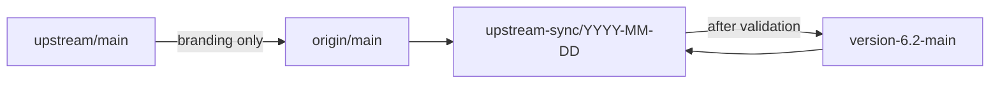

# Upstream synchronization

Standing procedure for bringing Sim upstream into this fork. The seam inventory for the sync merged into `version-6.2-main` is [version-6.1-main-vs-main.md](version-6.1-main-vs-main.md). This document is the procedure. That report is the file-by-file map for that merge. The next sync compares `version-6.2-main` with `origin/main`. Do not treat a sync as conflict resolution.

The objective is to keep as much upstream functionality as practical, preserve required Arena behavior, assess and communicate every positive or negative behavioral impact, and make every sync smaller than the last by splitting or wrapping customizations out of upstream files.

## Branches

| Remote | Branch | Role |
|---|---|---|
| `upstream` (`simstudioai/sim`) | `upstream/main` | Read-only Sim. Never commit to it. |
| `origin` (`arena-position2/p2-sim`) | `origin/main` | Intake. Sim `main` plus branding (logos and the docs title). Not the product. |
| `origin` | `version-6.2-main` | Current product branch. Arena behavior lives here. |
| `origin` | `version-6.1-main` | Previous product line. Not the sync target. |
| `origin` | `upstream-sync/YYYY-MM-DD` | Integration branch, cut from `version-6.2-main`. |

There is no `version-6.2-prod`. Older lines (`version-6.1-main`, `version-5-prod`, `v2-main-prod`, `release/prod`) are not the sync target. When the product line is renamed, update this file and `.claude/rules/upstream-sync.md`, then run `bun run skills:sync`.

Local `main` is stale. After `git fetch`, use `origin/main`.



The product sync merges `origin/main` into the integration branch. `origin/main` must already contain the upstream commits you intend to take, with only branding kept on top. Merging `upstream/main` straight into `version-6.2-main` skips that branding. Do not sync on `main` or directly on `version-6.2-main`.

## Customization states

Every Arena customization falls into one of three architectural states:

1. **Separate Implementation** — Lives in Arena-only files and directories (`ArenaDeployedChat.tsx`, `apps/sim/local-copilot/**`, `apps/sim/lib/billing/arena/**`, `apps/sim/tools/unipile/**`). Zero conflict with upstream.
2. **Wrapped on Top** — Calls or renders upstream's unmodified code and applies Arena behavior before, after, or around it through a thin registration spread, hook, or wrapper (`ARENA_CUSTOM_BLOCK_REGISTRY` in `apps/sim/blocks/registry-maps.ts`, `arenaToolRegistry` in `apps/sim/tools/registry.ts`, `arenaServerToolRegistry` in `apps/sim/lib/mothership/tools/server/router.ts`, `packages/db/arena-schema.ts` re-exported from `packages/db/schema.ts`, `LaunchDeployedChat` rendered beside Run in `panel.tsx`).
3. **Overridden in Place (Merge Debt)** — Edits made directly inside an upstream function body or file. These collide on future syncs and risk silent regression when Git auto-merges around them.

## Principles

1. **Split or wrap on touch.** Whenever an upstream sync conflicts in—or touches—a file that is still **Overridden in Place**, do not merely re-patch the conflict in place when a seam can be extracted. Move the Arena logic into a separate module or wrapper during that sync so the upstream file returns to stock plus a one-line call or spread. Product name and logo go through `apps/sim/ee/whitelabeling`.
2. **Adopt upstream improvements and assess impact.** When an upstream change adds a feature, fixes a bug, improves performance, or refactors shared code, take upstream. Evaluate whether the upstream change affects current product behavior in a **positive way** (fixes a race, improves speed, adds capabilities, blocks invalid logs) or a **negative/breaking way** (tightens a check that rejects Arena payloads, alters defaults like theme or timeout caps, requires cloud worker state that Local Copilot does not have). Alert the user to both positive and negative behavioral impacts before finalizing the sync.
3. **Capture and diff same-feature overlaps.** When both Arena and upstream implement the same or overlapping functionality, do not assume same name means same feature, and do not resolve automatically. Capture the overlap in the sync report and diff both implementations across:
   - Problem solved and user-facing UX
   - API routes and request/response contracts
   - Data model, schema, and state ownership
   - Edge cases, security, tenancy, and backward compatibility
   Then classify the resolution:
   - **Adopt upstream** when upstream is equivalent or strictly better, and remove the duplicate where safe.
   - **Wrap upstream** when upstream is the right base and Arena still needs specific behavior layered on top.
   - **Keep separate** when Arena's implementation serves a distinct product requirement upstream does not meet. Record why in the sync report.
   - **Replace custom** when upstream fully supersedes an older Arena workaround. Remove the obsolete code and its tests.
4. **Preserve required behavior, not the old implementation.** When upstream edits a file that also contains Arena behavior, never blindly accept theirs, accept ours, or keep whichever side is newer. If upstream replaces implementation A with implementation B, re-apply the required Arena behavior on B—preferably as a wrapper around B.

## Classify each overlap

| Category | Situation | Action |
|---|---|---|
| 1. Independent upstream change | No interaction with Arena behavior | Adopt upstream; assess and note any positive/negative product impact |
| 2. Same file, different behavior | Both changes can coexist | Merge both on upstream's control flow; extract Arena logic into a wrapper/helper if feasible |
| 3. Same functionality (overlap) | Upstream implemented something Arena already built or customized | Capture and diff both implementations (API, data model, UX, edge cases); alert user and choose `Adopt`, `Wrap`, or `Keep Separate` |
| 4. Upstream refactor | Upstream moved or rewrote code that contains Arena behavior | Port the required Arena behavior onto the new structure as a wrapper |
| 5. Behavioral conflict | Upstream contradicts a required Arena product rule | Keep the required Arena behavior; take unrelated upstream improvements; alert user |
| 6. Obsolete customization | Upstream now natively covers the requirement | Remove the custom code after confirming no Arena-specific edge case is lost |

On files only upstream changed since the merge-base, take upstream. Exclusive Arena trees come back as new files. Registries (`apps/sim/blocks/registry-maps.ts`, `apps/sim/tools/registry.ts`, `integrations.json`, `packages/db/schema.ts`, and the Mothership server router `apps/sim/lib/mothership/tools/server/router.ts`) take upstream, then re-attach the Arena spread or re-export:

- `apps/sim/blocks/registry-maps.ts` spreads `ARENA_CUSTOM_BLOCK_REGISTRY` and `ARENA_CUSTOM_BLOCK_META_REGISTRY`.
- `apps/sim/tools/registry.ts` spreads `arenaToolRegistry` from `apps/sim/tools/arena-registry.ts`.
- `apps/sim/lib/mothership/tools/server/router.ts` takes upstream's `baseServerToolRegistry` and spreads `arenaServerToolRegistry` only inside `getServerToolRegistry`.
- `packages/db/schema.ts` takes upstream's tables and re-exports `packages/db/arena-schema.ts` at the bottom.

## Workflow

### 1. Read the repository before editing

Record `git status`, the current branch, both remotes, and how far `version-6.2-main` and `origin/main` have diverged from each other and from `upstream/main`. Find the merge-base. Do not modify the worktree until that picture is written down.

If `origin/main` is behind `upstream/main`, stop the product sync and update the intake branch first: take upstream, keep branding only. Then cut the integration branch.

Before switching away from `version-6.2-main`, dump the pre-sync block output contracts:

```bash
bun run apps/sim/scripts/diff-block-output-contracts.ts dump --out /tmp/output-contracts-before.json
```

### 2. Fetch

```bash
git fetch upstream
git fetch origin
```

`upstream/main` stays read-only.

### 3. Integration branch

```bash
git switch -c upstream-sync/YYYY-MM-DD origin/version-6.2-main
git merge origin/main
```

Use the fetched tips. Inspect the upstream range before resolving overlaps: commit count, files, features, refactors, API changes, schema changes, dependency changes, and files that also contain Arena edits. Prioritize those overlaps. The gap report's conflict index is the default class per area for the current merge.

### 4. Identify Arena customizations, diff same-feature overlaps, and assess impact

Use history, commit messages, tests, project config, and `git log -S` / `git log -G` before changing a difference you do not understand. A difference that is not documented can still be intentional.

Behavior added on `version-6.2-main` after the 2026-10-14 sync is required even when the file is mostly upstream. Re-apply that behavior on upstream's structure. Do not keep Arena's whole copy of the file, and do not drop the behavior because upstream's file is newer. The file list and what to keep are in the merge checklist in [.agents/ARENA-NOTES.md](../../.agents/ARENA-NOTES.md) under "Re-apply on the next upstream sync". The manual pass for those behaviors is [manual-regression-checklist.md](manual-regression-checklist.md).

While reviewing the upstream commit range:

- **Assess positive and negative behavioral impacts**: Identify every upstream fix, improvement, or change that affects existing workflows, chat, copilot, billing, auth, or UI behavior. Flag any change that alters observable behavior (positively or negatively) to alert the user.
- **Diff overlapping features**: Whenever upstream adds or changes a feature that overlaps with an Arena feature or customization, document the diff between Arena's implementation and upstream's implementation in the report.

### 5. Resolve conflicts by splitting or wrapping

Keep upstream's structure. Insert only the Arena behavior that is still required. Whenever practical, extract in-place Arena edits into a helper, wrapper, or registry spread so the upstream file is no longer overridden in place on the next sync. Do not reformat, rename, reorder imports, or restyle unrelated code.

Do not run `git checkout --ours` or `git checkout --theirs` for a conflict unless the person running the sync explicitly asks for that. Resolving a large conflict by taking one side entirely requires confirmation.

### 6. Regenerate derived artifacts (mandatory before contract diffs and audits)

Never hand-merge generated files, and never run contract diffs before regenerating tool and schema artifacts (stale `tool-outputs.ts` from upstream omits Arena tools and produces hundreds of false-positive removed output paths).

Run the generators in order:

```bash
bun run generate:tool-metadata
bun run scripts/generate-schema-mock.ts
bun run generate:deployment-config
bun run generate:block-successors
bun run scripts/generate-docs.ts
bun run generate:docs-manifest
bun run skills:sync
```

### 7. Diff block and subblock input/output schemas

A clean merge does not mean saved workflows still run. Workflows store references such as `<BlockName.field>` against the object the tool returns, and store input values under `subBlock.id`. Upstream can rename, remove, or retype a field or subblock in a file this fork never edited, so Git reports no conflict.

#### Output schemas (`block`, `tool`, and `trigger`)

On the integration branch, after regenerating tool metadata in Step 6:

```bash
bun run apps/sim/scripts/diff-block-output-contracts.ts diff /tmp/output-contracts-before.json
```

The script compares block type, operation, path, type, and source (`block`, `tool`, or `trigger`). Added paths are safe. Removed paths and type changes are breaking. A removed path plus a new path with the same leaf name, on the same block, operation, and source, is a rename candidate. The command exits non-zero when anything breaking remains.

A breaking row blocks the sync until one of these is true:

- A compatibility alias still writes the old key from the new value, so existing `<BlockName.oldField>` references resolve. Hide the alias from the editor when the new field is the one builders should pick. A type change cannot be fixed with an alias.
- The sync report names the path, assesses downstream workflow impact, and records that no saved workflow references it.

When a database is available, scan stored workflow state for the breaking paths. Each block has a `type`. Downstream subblock values hold `<Name.path>` references. Match the path to that block's type and selected operation.

#### Input and subblock schemas

Subblock id removals must be mapped in `SUBBLOCK_ID_MIGRATIONS` (`apps/sim/lib/workflows/migrations/subblock-migrations.ts`), and required `user-only` tool parameters must align with a block's `subBlock.id` or `canonicalParamId`. Run the block-registry check against the pre-sync product tip:

```bash
bun run apps/sim/scripts/check-block-registry.ts version-6.2-main
```

Record all block/subblock input and output schema changes and their impact in Section 4 of the sync report.

### 8. Verify (full gate and Arena seam check)

Use `bun` and `bunx`. Run the verification gate before declaring the sync ready:

```bash
bun run check:arena-seams
bun run type-check
bun run check:audits
bun run check:migrations version-6.2-main
```

Run the targeted Vitest suites covering touched customizations and Arena seams (including `apps/sim/lib/billing/arena`, `apps/sim/local-copilot`, `apps/sim/lib/auth`, `apps/sim/executor/execution/engine.test.ts`, `apps/sim/components/settings/navigation.test.ts`, and `apps/sim/lib/mothership`). Run the build and integration or E2E tests when the sync touches those paths.

When a test fails, decide whether the cause is an upstream behavior change, a bad merge, obsolete Arena code, a dependency change, or an intentional product difference. Do not edit a test only to make it pass. Tests that encode required product behavior stay.

### 9. Report and alert

Write the comprehensive sync report below (`docs/upstream/sync-YYYY-MM-DD.md`) and alert the user to any positive or negative behavioral changes, same-feature overlap decisions, and block/subblock schema impacts. Merge the integration branch into `version-6.2-main` only after that report and verification pass.

## Fork-specific constraints

- **Database.**
  - Arena-exclusive tables live in `packages/db/arena-schema.ts` and are re-exported from `packages/db/schema.ts`.
  - Do not replay Arena migrations that reuse upstream's numeric filenames (`0116`, `0148`, `0239`, `0248`–`0252`, `0294`, `0295`). Those numbers belong to upstream migrations in `packages/db/migrations/meta/_journal.json`.
  - Keep `packages/db/migrations/0411_project_membership_enforcement.sql` as `SELECT 1;` — script migration `0032` owns the column-authority switch. If upstream changes `0411_*`, keep the SQL stub and reconcile in script migrations.
  - Do not hand-merge `packages/db/migrations/meta/*_snapshot.json` or blindly run `drizzle-kit generate` while unjournaled `Arena_*` tables differ from upstream's latest snapshot. Take upstream's journaled migrations and snapshots, and author any new migration with the `db-migrate` skill and `bun run check:migrations version-6.2-main`.
- **Dependencies.** Read version bumps, breaking changes, peer dependencies, and security updates. Do not downgrade an upstream dependency only to make a conflict disappear.
- **APIs.** Adapt Arena code to the new upstream API. Keep a compatibility surface when an external consumer still depends on the old one.
- **UI.** Take upstream's component structure. Re-apply Arena as the minimum: labels, a hub return link, an org-admin gate, and behavior that whitelabeling cannot express.
- **Generated files.** Never hand-merge them; regenerate them in Step 6.

## Before removing Arena behavior

Record why the customization exists, whether the requirement still exists, whether upstream now covers it, and whether removal changes observable behavior. If the reason is unclear, leave the code and flag it in the report.

## Commits

Use the repository's conventional commit style. Name the Arena behavior in the message when a commit preserves, wraps, or changes it. Do not invent a parallel customization id scheme, and do not rewrite history to add one. The sync report is the record of each decision.

## Sync report template

Every upstream sync must produce a report following this exact structure:

```markdown
# Upstream Sync Report — YYYY-MM-DD

## 1. Merge Highlights

- **Previous upstream commit**: `<sha>` (`<tag>`)
- **New upstream commit**: `<sha>` (`<tag>`, `upstream/main`)
- **Intake branch (`origin/main`)**: `<sha>`
- **Pre-sync product branch (`version-6.2-main`)**: `<sha>`
- **Integration branch**: `upstream-sync/YYYY-MM-DD`
- **Upstream commits merged**: `<count>`
- **Files changed**: `<count>`
- **Conflicts resolved**: `<count>`
- **Overrides converted to Split / Wrapped seams in this sync**: `<list of files extracted or wrapped>`
- **Executive Summary**: `<2–4 sentences summarizing major upstream additions, fixes adopted, and overall sync health>`

---

## 2. Major Impact & Behavioral Changes (Positive & Negative)

Alert the user to every upstream improvement, fix, or change that affects observable behavior across stock or customized features.

| Feature / Area | Impact Direction (`Positive Improvement` \| `Negative / Regression Risk` \| `Neutral Change`) | What Changed Upstream | Impact on Current Arena Behavior | Action Taken (`Adopted` \| `Guarded` \| `Wrapped` \| `Reverted Override`) |
|---|---|---|---|---|
| | | | | |

---

## 3. Same-Feature Overlap Diffs (Arena vs. Upstream)

Cases where both Arena and upstream have implemented the same or overlapping functionality.

| Feature / Functionality | Arena Implementation | Upstream Implementation | Diff (UX, API, Data Model, Security, Edge Cases) | Decision (`Keep Separate` \| `Wrap Upstream` \| `Adopt Upstream` \| `Keep Override`) & Reason |
|---|---|---|---|---|
| | | | | |

---

## 4. Block & Subblock Input and Output Schema Changes

### 4.1 Output Schema Changes (`diff-block-output-contracts.ts`)

- **Total Removed Paths**: `<count>`
- **Total Type Changes**: `<count>`
- **Total Added Paths**: `<count>`
- **Rename Candidates**: `<count>`

| Block | Operation | Source (`block` \| `tool` \| `trigger`) | Path | Change (`removed` \| `type: A -> B` \| `added`) | Downstream Workflow Impact | Decision (`alias` \| `accept` \| `blocked`) & Notes |
|---|---|---|---|---|---|---|
| | | | | | | |

### 4.2 Input / Subblock Schema Changes (`check-block-registry.ts`)

- **Subblock ID Stability**: `<Pass / Fail>`
- **Canonical-ID Contract**: `<Pass / Fail>`
- **Integration Meta Coverage**: `<Pass / Fail>`
- **Sunset `replacedBy`**: `<Pass / Fail>`
- **Selector Coercions**: `<Pass / Fail>`

| Block | Subblock / Param ID | Change (`subblock removed` \| `canonicalParamId` \| `new input` \| `type/options changed`) | Migration / Fix (`SUBBLOCK_ID_MIGRATIONS` or block update) | Saved Workflow Impact |
|---|---|---|---|---|
| | | | | |

---

## 5. Master Feature Inventories & Sync Change Tracking

### 5.1 Arena-Only Features

Features that exist exclusively in Arena with no upstream Sim equivalent.

| Feature / Module | Location | Touched / Changed in This Sync? (`Yes` \| `No`) | What Changed & Impact |
|---|---|---|---|
| Local Copilot Runtime & UI | `apps/sim/local-copilot/**`, `packages/db/arena-schema.ts` | | |
| Arena Task Block & Tools | `apps/sim/blocks/blocks/arena.ts`, `apps/sim/tools/arena/**`, `apps/sim/app/api/tools/arena/**` | | |
| Arena Development & Generated Apps | `apps/sim/blocks/blocks/arena-development.ts`, `development.ts`, `apps/sim/tools/arena-development/**`, `apps/sim/lib/development/**` | | |
| Ads Integrations (Bing Ads, Facebook Ads, Google Ads V1) | `apps/sim/blocks/blocks/{bing_ads,facebook_ads,google_ads_v1}.ts`, `apps/sim/lib/internal/*-ads/**` | | |
| Figma Block & Design Generator | `apps/sim/blocks/blocks/figma.ts`, `apps/sim/tools/figma/**`, `apps/sim/lib/figma-design-generator.ts` | | |
| Image Fusion Block | `apps/sim/blocks/blocks/image_fusion.ts`, `apps/sim/tools/image_generation/**` | | |
| P2 Docs & Presentation Blocks | `apps/sim/blocks/blocks/{p2_docs,presentation}.ts`, `apps/sim/tools/{p2_docs,presentation}/**` | | |
| SEO Blocks (Semrush, SpyFu) | `apps/sim/blocks/blocks/{semrush,spyfu}.ts`, `apps/sim/tools/{semrush,spyfu}/**` | | |
| LinkedIn (Unipile) Block & Hosted Auth | `apps/sim/blocks/blocks/unipile.ts`, `apps/sim/tools/unipile/**`, `apps/sim/lib/unipile/**` | | |
| Skyvern Block & Tools | `apps/sim/tools/skyvern/**` | | |
| Chart Generator Block & ECharts Renderer | `apps/sim/blocks/blocks/chart_generator.ts`, `apps/sim/lib/chart-generation/**`, `apps/sim/executor/handlers/chart-generator/**` | | |
| Explicit Cost Block & Handler | `apps/sim/blocks/blocks/cost.ts`, `apps/sim/executor/handlers/cost/**` | | |
| Skill Share Catalog & Admin API | `apps/sim/lib/skill-share/**`, `apps/sim/app/api/admin/skill-share/**` | | |
| Agents List Allow-List & Video Builder (`emailId`) | `apps/sim/app/api/chat/agents/**`, video builder routes & Fal ledger attribution | | |
| Arena Commercial Billing Package | `apps/sim/lib/billing/arena/**` (Starter plan, flat org pricing `team_1950`/`team_6500`, upgrade presenter, supersede Starter) | | |
| Arena Hub SSO & Session Resume | `apps/sim/lib/auth/{arena-sso,arena-sso-path,arena-sim-resume,legacy-session-cookie-clears,session-cookie-domain}.ts` | | |
| Custom Organization OAuth Apps | `apps/sim/lib/oauth/{custom-apps,custom-app-config}.ts` | | |
| Deployed Chat Exclusive Modules | `ArenaDeployedChat.tsx`, `DeployedChatLanding.tsx`, `leftNavThread.tsx`, `FeedbackView.tsx`, `apps/sim/lib/chat/**` (departments, golden queries, prompt feedback, banner messages) | | |
| Arena General Settings & Help/Support Issues | `/workspace/arena-general-settings`, `helpSupportIssue` table & API | | |

### 5.2 Arena Customizations (on Upstream Features)

Features where Arena customizes, wraps, or overrides an upstream Sim feature.

| Feature / Customization | Customization Type (`Separate Implementation` \| `Overridden in Place` \| `Wrapped on Top`) | Key Files / Seams | Touched / Changed in This Sync? (`Yes` \| `No`) | What Changed & Impact |
|---|---|---|---|---|
| Deployed Chat Page & Runtime | `Separate Implementation` (`ArenaDeployedChat`) + `Overridden in Place` (`api/chat/[identifier]/route.ts`, `use-chat-streaming.ts`) | `apps/sim/app/(interfaces)/chat/[identifier]/page.tsx`, `apps/sim/app/api/chat/[identifier]/route.ts` | | |
| Deployed Chat Knowledge Reference Modal | `Overridden in Place` | `apps/sim/app/(interfaces)/chat/components/message/components/knowledge-results-modal.tsx` (`deployed-chat` class) | | |
| Workflow Builder Panel Launch Button | `Wrapped on Top` | `apps/sim/app/workspace/[workspaceId]/w/[workflowId]/components/panel/components/launch-deployed-chat.tsx` in `panel.tsx` | | |
| Block, Tool, Mothership & Schema Registries | `Wrapped on Top` | `apps/sim/blocks/registry-maps.ts`, `apps/sim/tools/arena-registry.ts`, `apps/sim/lib/mothership/tools/server/arena-registry.ts`, `packages/db/arena-schema.ts` | | |
| Identity, Branding & Sidebar Shell | `Wrapped on Top` (`ee/whitelabeling`, `public/**`) + `Overridden in Place` (`sidebar.tsx`, `icons.tsx`, `docs/app/layout.tsx`) | `apps/sim/ee/whitelabeling/**`, `apps/sim/components/icons.tsx`, `apps/sim/app/workspace/[workspaceId]/w/components/sidebar/**` | | |
| Settings Navigation & Usage vs. Insights Split | `Overridden in Place` | `apps/sim/components/settings/navigation.ts`, `apps/sim/hooks/use-settings-navigation.ts`, `apps/sim/lib/settings/application/workspace-section-access.ts` (`forks` & `custom-blocks` hidden; `/settings/arena-usage` for members) | | |
| Billing Ledger Multiplier & `X-Sim-Email` Cross-Org Attribution | `Overridden in Place` + `Wrapped on Top` | `apps/sim/lib/billing/core/{usage-log,billing-attribution}.ts`, `apps/sim/app/api/v2/workflows/[workflowId]/execute/route.ts`, `apps/sim/lib/workspaces/usage/**` | | |
| Personal Workspace on Signup | `Overridden in Place` | `apps/sim/lib/workspaces/**` (`ensurePersonalWorkspaceOnEmailSignup`, `isPersonal`) | | |
| Auth Trusted Origins, Proxy SSO Redirect & OAuth Scopes | `Wrapped on Top` (`proxy.ts` -> `buildArenaSimResumeUrl`) + `Overridden in Place` (`auth.ts`, `oauth.ts`, `credential-service.ts`) | `apps/sim/proxy.ts`, `apps/sim/lib/auth/auth.ts`, `apps/sim/lib/oauth/{oauth,credential-service}.ts` | | |
| Copilot Turn Recovery, Suggested Follow-Up & Stream Retry | `Overridden in Place` | `apps/sim/lib/mothership/request/lifecycle/{run,stream-retry,recovery-config}.ts`, `apps/sim/lib/mothership/transport/receiver.ts` | | |
| Local Copilot Chat Fork Fallback | `Overridden in Place` | `apps/sim/lib/mothership/chat/application/fork.ts` | | |
| Explicit User Stop Handling (`isExplicitStopReason`) | `Overridden in Place` | `apps/sim/app/workspace/[workspaceId]/home/hooks/stream/{handle-error-event,turn-model}.ts` | | |
| Copilot HTML File Guards & Finished Reply Scroll Formatting | `Overridden in Place` | `apps/sim/lib/copilot/tools/server/files/{create-file,workspace-file,patch-search-replace,html-edit-size-guards}.ts`, `message-content.tsx` | | |
| Workflow Engine: Response-in-Loop, Empty `forEach` & Nested Subflows | `Overridden in Place` | `apps/sim/executor/execution/engine.ts`, `apps/sim/lib/workflows/editing/{builders,operations,validation}.ts` | | |
| Function Sandbox 60-Minute Timeout Cap | `Overridden in Place` | `apps/sim/lib/execution/constants.ts` (`DEFAULT_EXECUTION_TIMEOUT_MS = 3_600_000`), `function-handler.ts`, `execute-request.ts` | | |
| Model Catalog & OpenRouter Free-Only Filter | `Overridden in Place` | `apps/sim/providers/models.ts`, `apps/sim/blocks/utils.ts` | | |
| Extended Upstream Integrations (Slack, HubSpot, Slides, Zoom, Shopify, Gmail, Drive, Image Variations) | `Wrapped on Top` (extra tool files) + `Overridden in Place` (block files & `resolve-image-count.server.ts`) | `apps/sim/blocks/blocks/{slack,hubspot,google_slides,zoom,shopify,image_generator}.ts`, `apps/sim/lib/image-generation/**` | | |
| Default Light Theme & Dark Mode Editor Popovers | `Overridden in Place` | `apps/sim/lib/users/queries.ts`, `packages/db/schema.ts`, `apps/sim/app/_styles/globals.css` | | |
| Database Migration `0411` Stub | `Overridden in Place` | `packages/db/migrations/0411_project_membership_enforcement.sql` (`SELECT 1;`) | | |

### 5.3 Sim-Only (Stock Upstream) Features

Core Sim features used as-is from upstream.

| Feature / Surface | Area | Touched / Changed in This Sync? (`Yes` \| `No`) | What Changed & Impact |
|---|---|---|---|
| Workflow Builder Canvas, Nodes, Edges & Serializer | `apps/sim/app/workspace/[workspaceId]/w/[workflowId]/**`, `apps/sim/serializer/**` | | |
| Realtime Collaborative Editing (`apps/realtime`) | `apps/realtime/**`, `packages/realtime-protocol/**` | | |
| Core Workflow Blocks (Agent, API, Condition, Router, Loop, Parallel, Evaluator, Guardrails) | `apps/sim/blocks/**`, `apps/sim/executor/handlers/**` | | |
| Triggers (Schedule, Webhook, API, Polling) | `apps/sim/triggers/**`, `apps/sim/lib/webhooks/**` | | |
| Knowledge Bases, Embeddings & Document Connectors | `apps/sim/lib/knowledge/**`, `apps/sim/connectors/**` | | |
| Tables & Column-Type Registry / Enrichments | `apps/sim/lib/table/**`, `apps/sim/enrichments/**` | | |
| Workspace Files & Storage Provenance | `apps/sim/lib/uploads/**`, `apps/sim/app/api/files/**` | | |
| Workspace Skills (Stock CRUD & Agent Attachment) | `apps/sim/lib/skills/**` | | |
| Execution Logs, Workflow Tests, Dashboards & Changelog | `apps/sim/lib/logs/**`, `apps/sim/app/workspace/[workspaceId]/{logs,tests,dashboards,changelog}/**` | | |
| Enterprise Permission Groups, RBAC & Audit Logs | `apps/sim/ee/**`, `packages/platform-authz/**`, `packages/audit/**` | | |
| Stock Integrations & OAuth Token Refresh Engine | `apps/sim/tools/**`, `apps/sim/lib/oauth/**` | | |
| MCP Servers, v2 Public API, CLI & SDKs | `apps/sim/app/api/v2/**`, `packages/{cli,sim-cli,ts-sdk,python-sdk}/**` | | |
| Desktop App (`apps/desktop`) | `apps/desktop/**`, `packages/desktop-bridge/**` | | |

---

## 6. Verification & Gate Results

- **Arena Seams Check (`bun run check:arena-seams`)**:
- **Type Check (`bun run type-check`)**:
- **Audits (`bun run check:audits`)**:
- **Migration Safety (`bun run check:migrations version-6.2-main`)**:
- **Output Contract Diff (`diff-block-output-contracts.ts`)**:
- **Block Registry Check (`check-block-registry.ts version-6.2-main`)**:
- **Unit & Seam Tests**:
- **Integration / E2E Tests**:
- **Build**:

## 7. Manual Review / Follow-Ups Required

- List any unresolved items, accepted contract breaks requiring DB workflow checks, or remaining in-place overrides scheduled for extraction.
```

## Safety

Stop and ask before:

- deleting significant Arena functionality
- dropping or renumbering migrations
- changing production behavior or a public API without alerting the user to the positive/negative impact
- force pushing or rewriting shared history
- resolving a large conflict by taking only one side
- removing a customization whose purpose is unclear
- shipping a sync that still has a breaking output path or an unmapped subblock id

## Done

A sync is done when the required upstream changes and improvements are in, positive and negative behavioral impacts have been assessed and communicated to the user, overlapping features have been diffed, touched overrides have been split or wrapped where practical, obsolete duplicates are gone, all generators and verification gates pass, output and subblock contracts are compatible or explicitly accepted, and the complete sync report is written. The result must make the next sync smaller and safer than this one.
